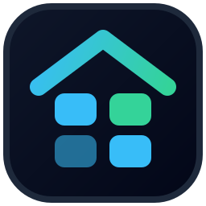

#  CaddyHome

[](https://github.com/DanieleTamborrino/caddyhome/actions/workflows/docker-build.yml)
[](./LICENSE)

**CaddyHome** is an ultra-lightweight, self-hosted homelab dashboard and startpage that automatically discovers services from your **Caddyfile** and/or **Caddy Admin API**.

Built as a single static **Go** binary with an embedded zero-build SPA frontend (`index.html`), CaddyHome consumes **< 10 MB of RAM at idle**, requires **zero external databases**, and preserves all your UI customizations (categories, card order, custom names, icons, and themes) across automatic Caddy syncs.

---

## ✨ Key Features

- **Automatic Caddy Discovery (`api` or `file`):**
  - **`api` (Default):** Queries the live Caddy Admin API (`/config/apps/http/servers`) to resolve nested `subroute` and `reverse_proxy` handlers.
  - **`file`:** Parses standard `Caddyfile` site blocks, multi-domain blocks, wildcard (`*.domain.tld`) blocks using `@matcher` + `handle @matcher`, and optional **magic comments** (`# @name`, `# @category`, `# @icon`).
- **Non-Destructive Reconciliation:**
  - Automatically adds newly discovered domains, updates internal LAN `upstreams`, and flags removed services as `Orphaned` (`active: false`) **without ever overwriting** user customizations made in the UI.
- **Dual-Link Navigation (External HTTPS vs. Direct LAN IP):**
  - **Primary Card Click:** Opens `https://<domain>` by default, or switches globally to direct LAN IP (`http(s)://<ip>:<port>`) when the **LAN Mode** toggle is enabled.
  - **Direct LAN Badge:** Every card includes a dedicated `LAN <ip>:<port>` pill that always opens the internal upstream directly—even when global LAN Mode is off—plus a dropdown for multi-upstream load-balanced services.
- **Drag & Drop Layout Editor:**
  - Reorder categories, drag service cards across categories, rename/delete categories, and hide internal services directly from the browser.
- **Automatic Favicons + Custom Logos & Wallpapers:**
  - Automatically discovers each service's favicon via `/api/favicon` (checks `/favicon.ico`, parses HTML `<link rel="icon">` / `apple-touch-icon`, and probes common paths like `/static/icons/favicon.ico` across LAN and external URLs, with client-side fallback and an inline SVG server icon).
  - Override any service logo via direct image upload, custom URL, or [walkxcode/dashboard-icons](https://github.com/walkxcode/dashboard-icons) slug.
- **Built-in Themes & Custom Background:**
  - Includes 5 color themes (**Dark**, **Light**, **OLED Black**, **Nord**, **Catppuccin**) powered by CSS variables, plus custom background wallpaper upload with adjustable overlay opacity and card blur.
- **Minimal Resource Footprint & Zero Disk Wear:**
  - State is served from RAM (`< 1ms` response time on `GET /api/state`) and persisted atomically to `/data/config.json` **only when changes actually occur**.

---

## 🚀 Quick Start

### 1. Docker Compose (Recommended)

Create a `docker-compose.yml` file:

```yaml
services:
  caddyhome:
    image: ghcr.io/danieletamborrino/caddyhome:latest
    # Or build locally:
    # build: .
    container_name: caddyhome
    restart: unless-stopped
    ports:
      - "8080:8080"
    environment:
      - PUID=1000
      - PGID=1000
      - PORT=8080
      - CONFIG_PATH=/data/config.json
      - CADDY_MODE=api
      - CADDY_API_URL=http://caddy:2019/config/
      - DEFAULT_LAN_IP=192.168.1.10
      # Used only when CADDY_MODE=file:
      - CADDYFILE_PATH=/etc/caddy/Caddyfile
      - SYNC_INTERVAL_SECONDS=60
    volumes:
      - ./data:/data
      # Required only when CADDY_MODE=file:
      - /path/to/your/Caddyfile:/etc/caddy/Caddyfile:ro
```

Start the container:

```bash
docker compose up -d
```

Open `http://localhost:8080` in your browser.

---

## ⚙️ Configuration & Environment Variables

| Variable | Default | Description |
| :--- | :--- | :--- |
| `PUID` | `1000` | User ID (UID) under which the `caddyhome` process runs inside the container (via `su-exec`). |
| `PGID` | `1000` | Group ID (GID) under which the `caddyhome` process runs inside the container (via `su-exec`). |
| `PORT` | `8080` | HTTP listening port for the web interface and API. |
| `CONFIG_PATH` | `/data/config.json` | Path to the persistent JSON state file. Uploaded images are stored alongside it in `/data/uploads/`. |
| `CADDY_MODE` | `api` | Discovery source: `api` (Caddy Admin API, default) or `file` (mounted `Caddyfile`). |
| `CADDY_API_URL` | `http://localhost:2019/config/` | Base URL of the Caddy Admin API (used when `CADDY_MODE=api`). |
| `CADDYFILE_PATH` | `/etc/caddy/Caddyfile` | Path to the mounted `Caddyfile` (used only when `CADDY_MODE=file`). |
| `DEFAULT_LAN_IP` | `127.0.0.1` | Host IP substituted when an upstream target is a Docker container hostname without dots (e.g. `jellyfin:8096` -> `http://192.168.1.10:8096`). |
| `SYNC_INTERVAL_SECONDS` | `60` | Background discovery sync interval in seconds (minimum `5`). |

---

## 🔍 Caddyfile Discovery & Magic Comments

CaddyHome supports both standard domain blocks and wildcard blocks with named host matchers. When a service uses a `@<tag> host <domain>` matcher (e.g. `@dreeve-zwift host dreeve-zwift.example.com`), its initial display name is derived from the `@` tag in Title/Camel words (`Dreeve Zwift`). You can also optionally annotate blocks with `# @name`, `# @category`, and `# @icon` comments:

```caddyfile
# @name Jellyfin Media
# @category Media
# @icon jellyfin
jellyfin.example.com {
    reverse_proxy jellyfin:8096
}

# Automatic HTTPS upstream detection via port (443, 8006, 8443, 9443) or transport tls
pve.example.com {
    reverse_proxy 192.168.1.2:8006 {
        transport http {
            tls_insecure_skip_verify
        }
    }
}

# Wildcard block with named matchers (@dreeve-zwift -> initial name "Dreeve Zwift")
*.example.com {
    @dreeve-zwift host dreeve-zwift.example.com
    handle @dreeve-zwift {
        reverse_proxy 192.168.1.30:8989
    }
}
```

### Upstream Normalization Rules
1. **Docker Container Names:** Upstreams without dots (excluding `localhost`), such as `sonarr:8989`, are automatically mapped to `<DEFAULT_LAN_IP>:8989`.
2. **Protocol Detection (`http` vs `https`):** Upstreams default to `http://` unless:
   - The target explicitly starts with `https://`
   - The block/route configures TLS transport (`transport http { tls ... }`)
   - The target port is in `443`, `8006`, `8443`, or `9443`.

---

## 🖥️ UI Features & Shortcuts

| Feature | How to Use |
| :--- | :--- |
| **Instant Search (`/`)** | Press `/` anywhere on the page to filter services by name, domain, or LAN `IP:Port`. Press `Esc` to clear. |
| **LAN Mode Toggle** | Click **`HTTPS` / `LAN ON`** in the top bar to switch the main card click between external `https://<domain>` and internal LAN URLs. |
| **Edit Layout (`Modifica`)** | Click **`Modifica`** to drag-and-drop cards between categories, reorder categories, create/rename categories, or edit individual cards. Click **`Salva`** to persist. |
| **Custom Logos & Favicons** | In Edit Mode, click a card to set a custom image URL, upload an image file, apply a `dashboard-icons` slug, or reset to automatic `/favicon.ico`. |
| **Themes & Wallpaper** | Click the palette icon in the top bar to switch between `Dark`, `Light`, `OLED`, `Nord`, and `Catppuccin`, or upload a custom background image. |

---

## 🔌 REST API Summary

| Method | Endpoint | Description |
| :--- | :--- | :--- |
| `GET` | `/` | Serves the embedded single-page application (`index.html`). |
| `GET` | `/api/favicon` | Discovers, proxies, and caches a service's favicon in RAM (`?domain=<domain>`). |
| `GET` | `/api/state` | Returns the current in-memory JSON state (`< 1ms`, zero disk/network I/O). |
| `POST` | `/api/sync` | Forces an immediate Caddy discovery & reconciliation cycle and returns the updated state. |
| `PUT` | `/api/state` | Validates and atomically persists a full state update from the UI to `/data/config.json`. |
| `POST` | `/api/upload` | Uploads a custom icon or background image (`multipart/form-data`, field `file`, max 10 MB) to `/data/uploads/`. |
| `GET` | `/uploads/*` | Serves uploaded custom icons and background images from `/data/uploads/`. |

---

## 🛠️ Local Development & Testing

### Prerequisites
- **Go 1.23+**

### Run Tests
```bash
go test -v -race ./...
```

### Build & Run Binary Locally
```bash
go build -o caddyhome .
CONFIG_PATH=./data/config.json CADDYFILE_PATH=./Caddyfile ./caddyhome
```

---

## 📄 License

Distributed under the **GNU General Public License v3.0**. See [LICENSE](./LICENSE) for full details.
